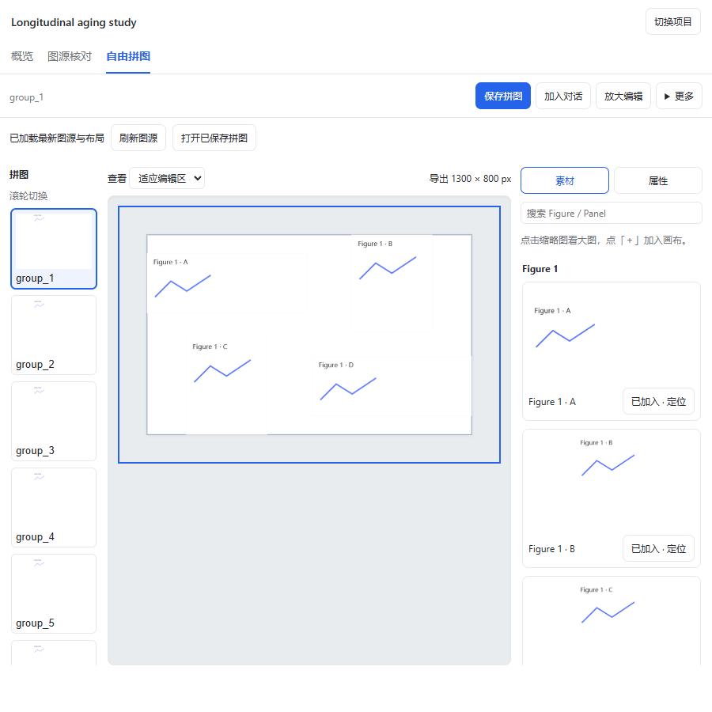

# Journal Club for DeepSeek Harness

[English](README.md) | [简体中文](README.zh-CN.md)

Turn a biomedical research paper into a figure-grounded journal club presentation, with editable crops, free-form compositions and speaker notes.

Journal Club is a plugin for [DeepSeek Harness](https://github.com/deepseek-ai/deepseek-harness). Ask the agent to work in your own paper folder, review figures in the workbench, and keep the results as ordinary Markdown, JSON and image files.

## Workbench preview



Browser fixture screenshot with synthetic figures, illustrating the composition editor; no paper content is included.

## What you can do

- Prepare an academic presentation from an original biomedical research PDF, with an evidence-linked analysis, outline and slide manuscript.
- Inspect figure sources, adjust panel crops and recover captions across pages.
- Arrange panels freely: drag, resize, refresh sources while preserving layout, and export tightly around the images. Original figure arrangements guide suggested layouts.
- Include all main-text figures and labeled panels by default; control talk duration through speaker-note detail, with human review and explicit exclusions.
- Use cropping, composition and validation independently, without starting a complete paper project.
- Export PPTX through the separately installed [dsh-ppt-maker](https://github.com/OMSociety/dsh-ppt-maker) plugin.

## Install from source

Requirements: Node.js **22.13 or newer** (Node 24 LTS recommended), npm, and a compatible DeepSeek Harness installation. The package targets DSH `>=0.2.0-0`; host APIs are still prerelease, so verify your installed host rather than assuming all later versions are compatible.

```sh
git clone https://github.com/zhang-bin-98/dsh-journal-club.git
cd dsh-journal-club
npm ci
npm run build
dsh plugin add .
```

Use the DSH profile you normally work in. Restart the host after installation or an update so both the client and host APIs reload.

For the complete workflow, install the official [MinerU CLI](https://github.com/opendatalab/MinerU-Ecosystem) (`npm install -g mineru-open-api`) and configure authentication using its `auth` command. High-precision parsing uploads the paper to MinerU. Model inference uses your host's configured provider. See [data boundaries](SECURITY.md).

PPTX output additionally needs dsh-ppt-maker in the same host. Without it, the Markdown manuscript, crops and compositions remain usable. This project is **not published to npm**. GitHub Release packaging is configured; until a release is published, use the source checkout above. Do not install by package name alone.

## Your first journal club

1. Open a separate paper workspace in DSH and attach the paper PDF. You do not need to work inside this plugin's source folder.
2. Ask: “Use journal-club to prepare a 15-minute biomedical journal club in Chinese, with all main figures and speaker notes.”
3. Open **Journal Club** in the right workbench. Review the sources and adjust crops, then confirm the figures in chat or through the workflow card.
4. Review the outline and slide manuscript at the next two confirmation points. Use **Free composition** to adjust figure groups; **Add to conversation** gives the agent a reference to the selected composition.
5. After a source crop changes, return to the composition and refresh sources. The current arrangement is preserved and saved with refreshed images. Review the final PPTX in PowerPoint before presenting.

The full workflow targets original biomedical research. Reviews and other paper types can still be used for a scoped figure task, but are not supported by the complete scientific-content workflow.

## Files stay yours

| File | Purpose |
|---|---|
| `jc.md` | Workflow notes and confirmation records |
| `analysis.md`, `outline.md` | Evidence analysis and narrative outline |
| `figures.json` | Figure sources, panel identities, captions and crop coordinates |
| `groups.json` | Composition identities, members and saved geometry |
| `slides.md` | Slide content and speaker notes |
| PNG / PPTX | Derived visual outputs |

The workbench reads these files. Editing a crop or composition keeps its identity; generated images and presentations are derived artifacts. Human inspection and adjustment are part of the workflow.

## Development and documentation

See [development and release](docs/development.md) for local tests, fixture downloads and the `main` / local `develop` workflow. Architecture and product documents are currently in Chinese: [documentation index](docs/README.md).

Report reproducible problems in [Issues](https://github.com/zhang-bin-98/dsh-journal-club/issues), using synthetic examples without private papers or credentials.

## License and acknowledgements

[MIT](LICENSE) for the project's software and original documentation. Third-party papers and figures retain their own licenses; real test papers are downloaded separately and are not bundled with the plugin.

Built on DeepSeek Harness, [MinerU](https://github.com/opendatalab/MinerU), and the dsh-ppt-maker ecosystem. SmartJC supplied the original workflow, scientific narration rules and reusable layout logic; the adaptation inventory is recorded in the [architecture](docs/architecture/架构设计.md).
